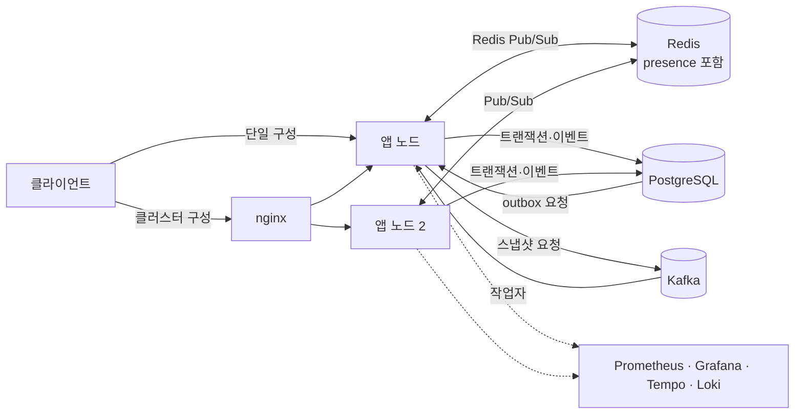

# 아키텍처

이 서비스는 세션 단위로 이벤트를 기록하고, 같은 순서 기준으로 실시간 전달과 시점 복원을 제공한다. 앱 노드는 요청 처리와 연결 관리를 맡고, 내구성 있는 기록은 PostgreSQL에 둔다.

## 한눈에 보기

단일 구성은 클라이언트가 앱에 직접 연결한다. 앱을 여러 대 띄우는 구성에서만 nginx가 앞단에 놓인다.

`compose.yaml`은 앱 한 대를 실행하고, `compose.cluster.yaml`은 앱 여러 대와 nginx를 추가한다. 앱은 이벤트를 DB에 커밋한 뒤 Redis로 발행하며, 스냅샷은 outbox를 거쳐 Kafka 작업자가 갱신한다. 관측 스택은 선택 프로필이며 평상시 애플리케이션 요청 경로에 포함되지 않는다.

## 구성 요소별 역할

| 구성 요소 | 맡은 일 | 상태와 실패 영향 |
|---|---|---|
| 앱 노드 | REST, STOMP, 인증·권한, 도메인 판정, 복원, outbox relay와 스냅샷 작업 | 연결·구독은 노드 안에 있다. 노드가 내려가면 클라이언트가 재연결하고 DB seq로 이어받는다 |
| PostgreSQL | 계정, 세션·참여자 현재값, 추가 전용 이벤트, 스냅샷, outbox 저장 | 순서와 커밋의 기준이다. 장애 동안 쓰기는 실패하거나 503이 된다 |
| Redis | 노드 사이 실시간 Pub/Sub, 사용자 연결 상태와 버전의 공유 | Pub/Sub는 보관하지 않는다. 복구 후 클라이언트가 이벤트를 DB에서 보충한다 |
| Kafka | 스냅샷 갱신 요청의 비동기 전달과 재시도·DLT | 메시지 중복은 허용하며 스냅샷 UPSERT가 오래된 결과를 막는다 |
| nginx | 클러스터 구성에서 HTTP와 WebSocket을 앱 노드에 분산 | 기본 설정은 연결 단위 분산이며 앱 노드 고정 세션은 요구하지 않는다 |
| 관측 스택 | 로그 검색, 지표 대시보드·알림, 분산 추적 | `obs` 프로필에서 Prometheus·Grafana·Tempo·Loki를 올린다 |

여기서 내구성 경계를 PostgreSQL로 둔 이유는 메시지 저장과 복원을 Redis/Kafka 전달 성공 여부에 종속시키지 않기 위해서다. 그 대가로 모든 쓰기는 세션 행을 잠그며, 같은 세션의 이벤트는 직렬 처리된다.

## 통신 방식 선택

실시간 통신은 서버가 저장하는 이벤트와 클라이언트 구독·재연결 흐름을 함께 고려해 선택했다.

| 방식 | 양방향성 | 서버 저장과의 관계 | 인프라·운영 | 이 과제에서의 판단 |
|---|---|---|---|---|
| WebSocket + STOMP | 한 연결에서 양방향 | 저장은 별도 트랜잭션으로 수행하고 seq로 전달·복원 | 상시 연결과 하트비트 필요, 프레임 규약과 구독 권한 제공 | 채팅 입력과 구독, 영수증을 한 연결에서 다뤄 채택 |
| SSE | 서버에서 클라이언트 방향, 입력은 별도 HTTP | 이벤트 저장과 잘 결합되지만 클라이언트 입력은 REST로 분리 | 재연결 규약은 단순하나 연결당 서버→클라이언트 스트림 | 양방향 대화에는 두 경로를 관리해야 해 미채택 |
| 롱폴링 | 요청·응답을 반복해 양방향 흉내 | 저장과 독립적이며 매 요청마다 상태 확인 | 연결보다 요청·응답 회전과 대기 요청 관리가 늘어남 | 구현은 가능하지만 연속 채팅에 불필요한 요청 비용 |
| WebRTC | 피어 간 양방향 미디어·데이터 | 서버의 권위 있는 이벤트 저장은 별도 구현 필요 | 신호 서버, NAT 통과, 피어 연결 운영이 추가됨 | 미디어 통화가 요구되지 않아 범위와 복잡도가 과함 |

STOMP는 구독 목적지별 인가와 표준 프레임을 이용하게 해 주지만, 내장 브로커는 노드 경계를 넘지 않는다. 따라서 다중 노드 전달은 Redis Pub/Sub로 보완하고, 전달 누락은 DB 기반 재개로 복구한다.

## 저장소와 브로커 선택

| 기술 | 사용 이유 | 가능한 대안 | 감수한 점 |
|---|---|---|---|
| PostgreSQL | 이벤트·현재 상태·outbox를 하나의 트랜잭션으로 커밋하고, seq·시간 검색과 JSONB 상태를 지원 | MySQL, 분산 SQL, 이벤트 로그 전용 저장소 | 단일 세션 쓰기는 행 잠금에 직렬화되고 이벤트 테이블 성장 관리가 필요 |
| Redis | 빠른 노드 간 알림과 원자적 presence 갱신(Lua)을 한 시스템에서 수행 | 앱 간 직접 연결, Kafka 전달, 외부 메시지 브로커 | Pub/Sub는 전달 보장과 재생이 없으므로 이벤트 원본으로 쓸 수 없음 |
| Kafka | 스냅샷 요청을 요청 처리 트랜잭션 밖에서 재시도·격리 | PostgreSQL 작업 테이블만 주기 조회, 동기 생성 | 브로커 운영과 중복 소비 처리가 추가되며, 현재 비동기 작업 종류는 제한적 |

PostgreSQL outbox가 DB 커밋과 작업 요청의 원자성을 제공한다. Kafka로 직접 보내면 DB 커밋은 됐지만 발행되지 않은 경우와, 발행은 됐지만 DB가 롤백된 경우를 함께 다뤄야 하므로 이 구성에서는 outbox를 선택했다.

## 애플리케이션 스택

Java 21과 Spring Boot를 사용한다. Spring MVC·Security·WebSocket/STOMP·Data JPA·Kafka의 생태계가 REST와 연결 수명주기, 트랜잭션, 작업자를 한 애플리케이션 안에서 구성하게 한다. JPA는 엔티티 생명주기와 현재 상태 갱신을 맡고, QueryDSL은 조건이 조합되는 세션·이벤트 검색에서 타입이 있는 동적 질의를 만든다.

네이티브 SQL은 ORM 추상화가 목적에 맞지 않는 곳에 한정한다. 세션 잠금은 `FOR UPDATE`, relay는 `FOR UPDATE SKIP LOCKED`, 스냅샷은 조건부 `INSERT ... ON CONFLICT`, outbox 삭제 권한과 이벤트 추가 전용 권한은 PostgreSQL DDL로 표현한다. 검색과 일반 엔티티 변경까지 네이티브 SQL로 넓히면 도메인 갱신 경로와 SQL이 이중화되므로 그 범위는 피했다.

## 모듈과 패키지 경계

모듈 경계는 도메인 규칙이 프레임워크와 저장 기술에 기대지 않도록 한다.

| 모듈 | 책임 | 의존 방향 |
|---|---|---|
| `chat-domain` | `SessionDecider`, `SessionReducer`와 값 객체. `build.gradle.kts`에 Spring 의존성이 없는 순수 Java 모듈 | 다른 모듈이 도메인 규칙을 사용한다 |
| `chat-persistence` | JPA 엔티티·저장소, QueryDSL 질의, Flyway 마이그레이션 | 도메인 타입을 저장 표현과 연결한다 |
| `chat-api` | Spring Boot 조립, REST·STOMP, 인증, 유스케이스, Redis·Kafka 연계 | 도메인과 persistence에 의존하고 요청 흐름을 조정한다 |

`chat-api/src/main/java/com/eventchat/*`의 패키지는 다음처럼 실제 책임을 나눈다.

| 패키지 | 역할 |
|---|---|
| `session` | 세션·이벤트 REST 유스케이스와 쓰기 상한, DTO |
| `stomp` | STOMP 인증 후처리, 목적지, 연결·구독·resume·전달 |
| `security` | 로그인·토큰·권한·감사 로그 |
| `restore` | 타임라인·스냅샷 계산과 응답 |
| `presence` | Redis presence 생명주기와 DB 기록 조정 |
| `realtime` | Redis 버스, 커밋 후 발행, 봉투와 상태 확인 |
| `worker` | outbox relay, Kafka 스냅샷 소비자, 작업 계측 |
| `web` | 공통 웹 설정, 요청 상관관계, 문제 응답, 연결 예산 검사 |

이 구분은 도메인 판정의 독립성을 높이는 대신, 요청 처리 흐름이 패키지 사이를 이동한다. 흐름의 진입점과 저장 순서는 아래 단계와 [데이터 모델과 쿼리](data-model.md)에 모았다.

## 쓰기 요청 흐름

REST 이벤트 입력과 STOMP 입력은 같은 `EventIngestor`와 `SessionWriter`를 거친다.

1. `SessionEventController` 또는 `StompEventController`가 요청을 받는다. `SecurityConfig`/`StompInboundInterceptor`가 토큰과 인증 주체를 확인한다.
2. `EventIngestor`는 허용된 이벤트 종류와 본문 길이를 검사한다. `SessionWriter`는 노드별 `Semaphore`를 즉시 얻는다. 허용량을 다 썼으면 기다리지 않고 503을 반환한다.
3. `SessionWriter.write` 트랜잭션 안에서 사용자를 읽고, `ChatSessionRepository.findForUpdate`로 세션 행을 잠근다. 멱등 이벤트를 먼저 조회해 같은 키의 재전송이면 이전 결과를 돌려준다.
4. 참여자 현재 행을 읽어 도메인 상태를 만들고 `SessionDecider`가 허용·거절·억제와 전이 이벤트를 판정한다.
5. `append`가 seq를 차례로 할당해 `session_event`에 추가하고, `ChatSession`과 필요한 `SessionParticipant` 필드를 갱신한다. 스냅샷 경계를 넘었거나 종단 상태면 같은 트랜잭션에 `event_outbox` 행도 쓴다.
6. DB 커밋 뒤 `CommittedEventRelay`가 Redis 발행을 수행한다. Redis 장애는 저장된 이벤트를 되돌리지 않으며 다음 재연결은 DB에서 보충한다.

세션 생성은 아직 잠글 세션 행이 없으므로 생성 멱등 키를 먼저 확인하고, 충돌 시 부분 유일 인덱스에 기대어 이미 커밋된 생성 결과를 다시 읽는다. 이 경로의 구체적 SQL 순서는 [핫패스 쿼리](data-model.md#핫패스-쿼리)에서 설명한다.

## 실시간 전달과 재연결

저장된 이벤트는 각 앱 노드의 로컬 STOMP 구독자에게 전달한다.

1. `CommittedEventRelay`가 트랜잭션 커밋 이후 `PatternRealtimeBus`로 세션 채널에 발행한다.
2. 모든 노드는 Redis 패턴 구독으로 봉투를 받고 `StompDelivery`를 통해 해당 노드의 로컬 세션 구독자에게 보낸다.
3. Redis Pub/Sub가 끊긴 동안의 이벤트는 되찾아주지 않는다. 클라이언트는 `SessionSubscriptions`에 마지막 수신 seq를 보내고, 서버는 구독 등록 후 DB 이벤트를 읽는다.
4. 복구 이벤트와 라이브 전달이 겹칠 수 있으므로 클라이언트는 이미 적용한 seq 이하를 버린다. 재생량이 상한을 넘으면 `SYSTEM_RESYNC` 뒤 REST 보충을 한다.

DB가 빠진 구간의 기준이기 때문에 Redis는 전달을 빠르게 하지만 데이터의 유일한 사본은 되지 않는다. 연결이 자주 끊기거나 보충량이 커지면 Redis 전달 지연과 `RESYNC` 비율을 함께 살펴야 한다.
