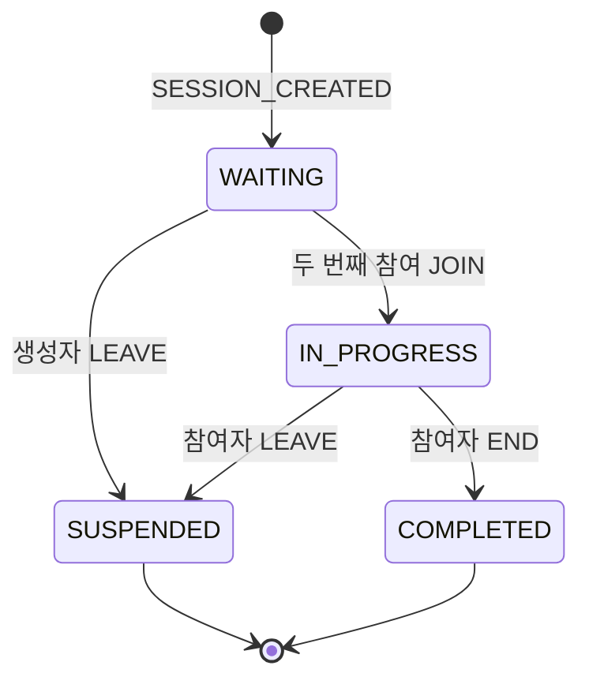
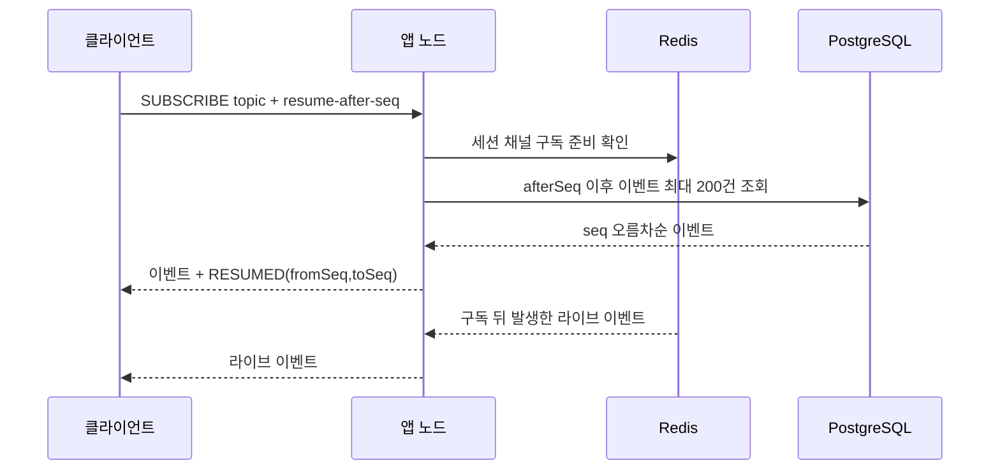
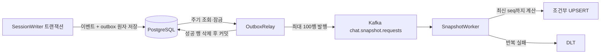

# 정합성과 상태 복원

이 문서는 이벤트의 순서·중복 규칙과, 연결이 끊겼거나 과거 시점을 조회할 때 상태를 다시 만드는 절차를 설명한다. 스키마와 인덱스는 [데이터 모델과 쿼리](data-model.md), 요청 계약은 [API](api.md)에 정리했다.

## 순서의 기준

같은 세션에서 의미 있는 순서는 서버가 커밋 트랜잭션 안에서 발급한 `seq`다. 서버 시각은 조회 기준, 클라이언트 시각은 보조 정보이지 순서 판단의 기준이 아니다.

| 후보 | 장점 | 채택하지 않은 이유 |
|---|---|---|
| 클라이언트 시각 | 사용자가 체감한 전송 시각에 가깝다 | 기기 시계 오차·수동 변경·오프라인 재전송으로 역전될 수 있다 |
| 서버 수신 시각 | 서버가 관측한 시점이라 기기 시계와 무관하다 | 동시 요청의 동일한 시각 해상도와 트랜잭션 대기 순서를 고유하게 구분하지 못한다 |
| 세션별 `seq` | 잠근 세션 행에서 순차 발급해 고유하고 결정적이다 | 같은 세션 안의 쓰기가 직렬화되어 그 세션의 처리량 상한이 생긴다 |

`client_ts`는 진단이나 클라이언트가 주장한 시각을 보존하는 데 쓴다. 수집 시 서버 시각은 직전 이벤트 시각보다 빠르지 않게 정하고, `seq` 오름차순으로 이벤트와 현재 상태를 한 트랜잭션에 기록한다. 따라서 시계가 크게 어긋난 클라이언트가 와도 복원 순서는 바뀌지 않는다.

## 중복과 멱등

각 명령 종류에 맞는 키를 사용한다. 저장된 요청 본문 해시와 재전송 본문이 다르면 성공처럼 처리하지 않고 충돌로 돌려준다.

| 키 | 적용 범위 | 저장 위치 | 같은 키·다른 본문 | 보관 기간 |
|---|---|---|---|---|
| `clientEventId` | 세션 안의 발신자 이벤트 | `session_event`의 키와 요청 해시, 부분 유일 인덱스 | `409 IDEMPOTENCY_KEY_REUSED` | 이벤트 보존 기간과 동일, 현재 만료 청소 없음 |
| 생성 `Idempotency-Key` | 발신자 세션 생성 | `SESSION_CREATED` 이벤트와 해시, 별도 부분 유일 인덱스 | 409 | 이벤트 보존 기간과 동일 |
| 명령 `Idempotency-Key` | 참여·퇴장·종료 요청 | 해당 명령 이벤트와 해시 | 409 | 이벤트 보존 기간과 동일 |
| typing·읽음 반복 | 현재 상태가 같은 연속 입력 | 새 이벤트를 쓰지 않음 | 본문 비교 키를 두지 않음 | 새 상태가 달라질 때까지 억제 |

멱등 조회는 도메인 상태 판정보다 먼저 이뤄진다. 예를 들어 이미 완료된 세션에서 처음 성공했던 종료 요청을 다시 보내도, 같은 키라면 새 상태 전이를 만들지 않고 처음 결과를 돌려준다. 키를 보존하는 대신 이벤트 로그가 계속 커지는 점은 보관 정책이 필요한 운영 비용이다.

## 세션 상태 머신

세션 상태는 이벤트 수집 전에 `SessionDecider`가 판정하고, 수락된 전이는 `chat_session` 현재값과 이벤트 로그에 함께 반영한다.

| 현재 \ 명령 | join(미참여자) | leave | end |
|---|---|---|---|
| `WAITING` | `IN_PROGRESS`로 전이 | 생성자가 나가면 `SUSPENDED` | `SESSION_NOT_STARTED` 거절 |
| `IN_PROGRESS` | `SESSION_NOT_JOINABLE` 거절 | `SUSPENDED` | `COMPLETED` |
| `SUSPENDED`, `COMPLETED`(종단) | `SESSION_NOT_JOINABLE` 거절 | `SESSION_NOT_ACTIVE` 거절 | `SESSION_NOT_ACTIVE` 거절 |

| 입력 | 기록 이벤트 | 상태 반영 |
|---|---|---|
| 생성 | `SESSION_CREATED`, 생성자 `JOIN` | `WAITING`, 생성자 참여 |
| 두 번째 참여 | `JOIN`, `SESSION_STATUS_CHANGED` | `IN_PROGRESS` |
| 나가기 | `LEAVE`, `SESSION_STATUS_CHANGED` | `SUSPENDED`, 참여자 비활성화 |
| 참여자 종료 | `SESSION_STATUS_CHANGED` | `COMPLETED`, 참여자 비활성화 |

참여자인지(`NOT_PARTICIPANT`, `PARTICIPANT_LEFT`)를 상태보다 먼저 확인한다. 관리자는 세션에 참여하지 않으므로 종료할 수도 없다.

퇴장 후 재참여는 허용하지 않는다. 두 사람으로 고정된 상담 범위에서는 재입장·재할당 규칙보다 단순한 종단 처리가 명확하다. 이 선택은 그룹 채팅이나 상담원 교체 기능을 추가할 때 상태 전이와 참여 이력 모델을 확장해야 한다는 제약을 만든다.

## Presence

소켓 연결 수는 Redis에서 사용자 단위로 추적하고, 세션 이벤트는 실제 온라인/오프라인 상태가 바뀔 때만 기록한다.

| 값 | 기본값 | 역할 |
|---|---:|---|
| 연결 유예 | 15초 | 잠깐의 네트워크 흔들림에 오프라인을 표시하지 않음 |
| 노드 하트비트 | 5초 | 해당 앱 노드가 살아 있음을 알림 |
| 노드 임대 만료 | 15초 | 죽은 노드가 소유한 연결을 정리할 시점 |
| 만료 검색 주기 | 2초 | 유예가 지난 연결을 정리 |
| 대조 주기 | 60초 | Redis 연결 집합과 노드 로컬 실제 소켓 집합을 비교 |

Lua 스크립트는 연결 집합 변경과 버전 증가를 원자적으로 수행한다. 노드 임대가 필요한 이유는 강제 종료 때 정상적인 WebSocket 종료 통지가 오지 않기 때문이다. 대조 작업은 등록·해제 중 프로세스가 끊기거나 Redis와 로컬 상태가 잠깐 어긋난 경우를 찾아 고친다. 따라서 표시가 즉시 바뀌는 대신 짧은 접속 단절을 숨기는 쪽을 택했다.

## Typing과 읽음 커서

일시 상태를 매 입력마다 영구 저장하면 이벤트와 DB 쓰기량이 대화 메시지보다 빠르게 늘어난다.

| 상태 | 억제 규칙 | 저장 효과 |
|---|---|---|
| Typing | 입력 유효 기간 10초, 최소 저장 간격 3초 | 같은 사용자의 짧은 반복 입력은 이벤트로 남기지 않음 |
| 읽음 커서 | 최소 저장 간격 1초, 커서가 가리키는 메시지 위치로 정규화 | 동일·근접 커서 반복을 줄이고 메시지 seq와 번호를 함께 보존 |

Typing은 만료 시각을 이벤트 시각에 10초를 더해 복원한다. 이 값들은 스냅샷의 리듀서 상태와 달리 시간이 흐르면 현재 시각에 따라 표시 여부가 달라질 수 있다. 너무 강하게 억제하면 UI 반응성이 떨어지므로, 전송량과 표시 신선도를 함께 조정해야 한다.

## 재연결과 resume

재연결 때는 구독 등록과 과거 이벤트 읽기 사이의 틈을 없애고, 겹친 이벤트는 클라이언트가 seq로 제거한다.

| 제한 | 기본값 | 초과 시 |
|---|---:|---|
| 이벤트 수 | 200건 | `SYSTEM_RESYNC` 전달 |
| 프레임 묶음 크기 | 256KB | `SYSTEM_RESYNC` 전달 |
| 노드 동시 resume | 3건 | 즉시 `SYSTEM_RESYNC` |

재생량이 한도를 넘으면 클라이언트는 마지막 적용 seq를 사용해 `GET /sessions/{id}/events?afterSeq=...`로 보충한다. 클라이언트는 이미 반영한 seq와 같거나 작은 이벤트를 다시 적용하지 않아야 한다. 이 규칙은 Redis 라이브 이벤트와 DB 재생의 겹침, 커밋 후 중복 발행 모두에 안전성을 준다.

## 상태 복원

타임라인은 응답에 필요한 상태와 화면 항목을 나눠 만든다. 화면 항목은 상태 계산의 입력이 아니므로 별도 제한 쿼리로 읽는다.

| 응답 대상 | 복원 근거 |
|---|---|
| 세션 상태·메시지 수 | 이벤트 리듀서 |
| 참여자, 역할·분류·표시 이름, 참여 여부 | 참여 관련 이벤트 |
| Presence와 typing | 이벤트와 기준 시각, typing TTL |
| 읽음 seq·메시지 번호, 미읽음 수 | 읽음·메시지 이벤트 |
| 화면 항목 | 표시 가능한 이벤트 유형만 조회, 기본 50·최대 200 |
| 복원 모드·스냅샷 seq·재생 건수·해시 | `restoredFrom` 메타데이터 |

전체 리플레이와 스냅샷 뒤 리플레이는 같은 `SessionReducer`를 사용한다.

| 방법 | 읽는 범위 | 선택 판단 |
|---|---|---|
| 처음부터 전체 리플레이 | seq 1부터 목표 seq까지 | 가장 단순하지만 이벤트가 늘수록 조회 행과 CPU가 선형으로 증가 |
| 스냅샷 + 리플레이 | 스냅샷 seq 이후 목표 seq까지 | 기본 선택이다. 스냅샷이 최신 기준 상태이고 남은 구간만 적용해 복원 비용을 줄인다 |

`TimelineService`는 `at`을 서버 시각의 밀리초 끝까지 포함하도록 넓혀 `session_event_ts_idx`에서 seq를 찾고, 그 seq의 서버 시각을 확인한다. `atSeq`는 이벤트 시각을 바로 읽는다. 유효한 스냅샷이 있으면 JSONB 상태에서 복원하고, 그 뒤 이벤트를 `(session_id, seq)` 순서로 최대 5000행씩 읽어 적용한다. 현재 구현은 빈틈을 별도 검사하지 않고, PK가 보장하는 정렬된 이벤트를 리듀서에 전달한다. 따라서 이벤트 행 유실 검출은 복원 과정이 아니라 비교·운영 점검에 의존한다.

리듀서 버전이 맞지 않거나 스냅샷이 목표 seq보다 앞서 있으면 전체 리플레이로 돌아간다. 이벤트는 메시지 본문을 제외한 상태 입력만 읽으며, `schema_version`이 지원되지 않으면 복원을 실패시켜 잘못된 상태를 조용히 만들지 않는다.

결정성 확인은 복원된 상태의 SHA-256 해시로 한다. `ignoreSnapshot=true`를 관리자 요청에 사용하면 같은 기준 seq를 처음부터 다시 적용해 스냅샷 기반 결과와 해시를 비교할 수 있다. `SessionReducerTest`와 `RestoreIT`가 리듀서와 API 복원 경로를 확인한다.

스냅샷은 이벤트가 100 단위 경계를 넘거나 세션이 종단 상태가 될 때 outbox 요청으로 생성한다. 매 이벤트마다 만들면 작은 상태를 반복 계산·쓰기 하므로 100건 단위를 택했다. 생성 주기는 리플레이 행 수와 지연 지표를 보고 조정할 수 있다. 현재는 세션당 최신 한 행만 저장하며, JSONB에는 상태·리듀서 버전·seq·해시가 들어가고 메시지 본문은 들어가지 않는다. 오래된 시점 조회는 스냅샷보다 과거면 전체 리플레이가 필요하다.

## 비동기 파이프라인

정합성이 즉시 필요한 이벤트 저장과 실시간 전달은 커밋 경로에 두고, 성능 최적화인 스냅샷 생성만 비동기로 분리했다.

| 동작 | 구현된 값 |
|---|---|
| Outbox 조회 | 1초 주기, 한 번에 최대 100행, `FOR UPDATE SKIP LOCKED` |
| Kafka 발행 대기 | 최대 차단 2초, 요청 제한 3초, 전체 전달 제한 5초 |
| 소비자 재시도 | 최초 지연 1초, 배수 2, 최대 지연 30초, 최대 5회 |
| 실패 격리 | 재시도 후 `chat.snapshot.requests.DLT`로 이동 |
| 수동 복구 | 관리자 `POST /sessions/{id}/snapshots`로 DB 최신 상태에서 다시 생성 |

Relay는 발행 성공한 행만 삭제한다. 발행 후 DB 삭제 커밋 전에 중단되면 같은 요청이 다시 나갈 수 있지만, 스냅샷 UPSERT는 기존보다 더 높은 seq 또는 다른 리듀서 버전만 반영한다. 작업자는 요청의 과거 `upToSeq`에 고정되지 않고 DB의 최신 이벤트까지 계산하므로 중복·역순 작업이 결과를 뒤로 돌리지 않는다. Kafka 소비자 그룹은 여러 작업자를 허용하며, 같은 세션에 대한 동시 계산은 최종 조건부 UPSERT가 오래된 값을 거부한다.

DLT 알림을 확인하면 먼저 원인을 고친 뒤 해당 세션의 스냅샷 API를 호출하고, DLT 메시지를 임의로 지우기 전에 실패 원인과 복구 결과를 기록한다. API 재생성은 DB 이벤트를 기준으로 하므로 Kafka 오프셋을 수동 이동하지 않아도 복구할 수 있다. DLT에 들어간 개별 메시지를 자동 재투입하는 절차는 구현되어 있지 않다.

## 메시지 수정·삭제를 추가한다면

현재 메시지는 변경 불가 이벤트이고, 화면 복원은 모든 메시지를 전송 완료 상태로 반환한다. 수정·삭제가 필요해지면 기존 이벤트를 고치지 말고 `MESSAGE_EDITED`와 `MESSAGE_DELETED`를 새 이벤트로 추가해야 한다.

전환 시에는 이벤트 스키마 버전을 올리고, 원 메시지 seq를 가리키는 식별자를 정의하며, `SessionReducer`가 최신 본문·삭제 여부를 결정적으로 재구성하도록 한다. 화면 항목 조회도 원 메시지와 변경 이벤트를 합쳐 최신 표현을 만들고, 권한 규칙과 감사 보존 기간을 정해야 한다. 이 변화는 타임라인 응답·검색 인덱스·스냅샷 호환성까지 바꾸므로 단순한 컬럼 업데이트로 처리할 수 없다.

## 알려진 한계

이 문서에서 다루는 복원 특유의 한계는 스냅샷이 최신 한 건뿐이고, 리플레이 범위의 누락을 자동 검출하지 않으며, typing과 presence가 이벤트 로그만으로 장기 보존되는 업무 기록이 아니라는 점이다. 이벤트 보존·파티셔닝과 용량 계획은 [데이터 모델과 쿼리](data-model.md), 운영상 경보와 복구는 [운영과 장애 대응](operations.md)을 본다.
