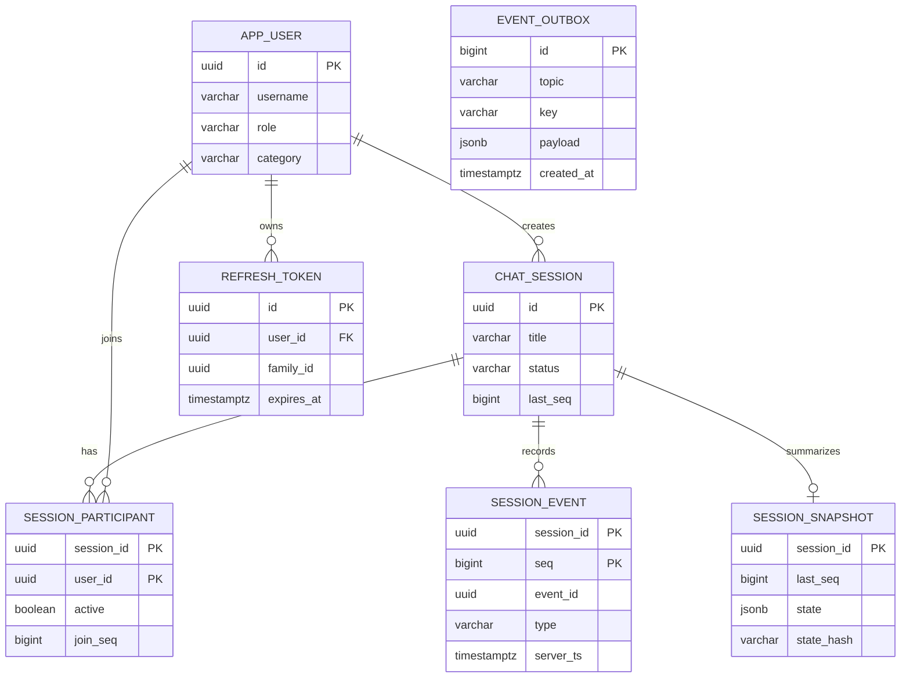

# 데이터 모델과 쿼리

[ERDCloud 다이어그램](https://www.erdcloud.com/d/ngEbEsraLRdZBRhsb)에는 테이블 7개와 관계, 인덱스·제약 메모가 있다.

아래 관계도는 핵심 키와 이벤트 순서 컬럼을 함께 보인다.



`event_outbox`는 이벤트 로그와 분리된 발행 대기 테이블이다. 일반 외래 키를 두지 않고 `key`와 JSON payload로 대상을 표현하므로 ERD에서 세션과 직접 연결하지 않는다.

## 테이블별 역할

| 테이블 | 역할 | 행 단위 | 쓰기 빈도 |
|---|---|---|---|
| `app_user` | 사용자·역할·분류 기준 | 사용자 1명 | 초기 시드·관리 변경 |
| `chat_session` | 현재 세션 상태와 seq·메시지 번호 카운터 | 세션 1개 | 세션 이벤트마다 현재값 갱신 |
| `session_participant` | 참여 당시 표시 정보와 현재 presence·typing·읽음 | 세션·사용자 1쌍 | 참여 및 참여자 상태 변화 |
| `session_event` | 복원 가능한 추가 전용 기록 | 세션 이벤트 1개 | 수락된 이벤트마다 삽입 |
| `session_snapshot` | 리듀서 상태의 최신 복원 기준점 | 세션 1개 | 100 seq 경계·종단 전이 후 비동기 갱신 |
| `event_outbox` | 커밋과 함께 보존하는 Kafka 발행 요청 | 발행 요청 1개 | 스냅샷 요청 시 삽입, 발행 성공 후 삭제 |
| `refresh_token` | 회전·폐기 가능한 로그인 갱신 토큰 | 토큰 1개 | 로그인·갱신·폐기 |

현재 상태 열을 함께 갱신하는 까닭은 쓰기 판정과 세션 목록을 빠르게 만들기 위해서다. 이벤트 로그가 복원 기준이고 현재 행은 같은 트랜잭션에서 유지하는 읽기용 표현이므로, 두 표현이 어긋나지 않게 쓰기 경계를 한 곳에 둔다.

## 핵심 DDL

다음 블록은 `chat-persistence/src/main/resources/db/migration/V20261021_2300__create_session_tables.sql`과 `V20261022_1000__create_session_snapshot.sql`의 원문이다.

### `chat_session`, `session_participant`, `session_event`, `event_outbox`

```sql
-- 상담 세션. 상태 머신 행이면서 세션별 seq 카운터다(쓰기는 이 행을 잠그고 순서를 정한다).
-- 제목·분류코드는 생성 후 바뀌지 않는다. 자주 바뀌는 컬럼에는 인덱스를 걸지 않아 HOT update를 살린다.
CREATE TABLE chat_session (
    id                uuid         PRIMARY KEY DEFAULT uuidv7(),
    title             varchar(100) NOT NULL,
    category          varchar(30)  NOT NULL,
    status            varchar(20)  NOT NULL,
    created_by        uuid         NOT NULL REFERENCES app_user (id),
    participant_count smallint     NOT NULL DEFAULT 0,
    last_seq          bigint       NOT NULL DEFAULT 0,
    last_event_at     timestamptz  NOT NULL,
    message_count     integer      NOT NULL DEFAULT 0,
    created_at        timestamptz  NOT NULL,
    started_at        timestamptz,
    ended_at          timestamptz,
    end_reason        varchar(20),
    CONSTRAINT chat_session_status_ck CHECK (status IN ('WAITING', 'IN_PROGRESS', 'SUSPENDED', 'COMPLETED')),
    CONSTRAINT chat_session_category_ck CHECK (category IN (
        'INSURANCE', 'BANK', 'HOSPITAL', 'FURNITURE', 'REAL_ESTATE',
        'COMMUNITY_CENTER', 'B2B_SALES', 'CUSTOMER_CENTER', 'CAR_SALES', 'TELECOM')),
    CONSTRAINT chat_session_end_reason_ck CHECK (end_reason IN ('LEFT', 'ENDED'))
) WITH (fillfactor = 90, autovacuum_vacuum_scale_factor = 0.05);

-- 목록은 created_at DESC, id DESC 키셋으로만 읽는다.
CREATE INDEX chat_session_created_idx ON chat_session (created_at DESC, id DESC);
CREATE INDEX chat_session_waiting_idx ON chat_session (created_at DESC, id DESC) WHERE status = 'WAITING';
CREATE INDEX chat_session_category_created_idx ON chat_session (category, created_at DESC, id DESC);
-- 제목 검색은 lower(title) LIKE '%q%'로 들어온다.
CREATE INDEX chat_session_title_trgm_idx ON chat_session USING gin (lower(title) gin_trgm_ops);

-- 참여자. 다시 참여할 수 없으므로 세션·사용자당 1행이다.
-- 역할·분류코드·표시 이름은 참여 시점 값을 복사해 둔다(과거 화면이 바뀌지 않도록).
CREATE TABLE session_participant (
    session_id         uuid        NOT NULL REFERENCES chat_session (id),
    user_id            uuid        NOT NULL REFERENCES app_user (id),
    role               varchar(20) NOT NULL,
    category           varchar(30) NOT NULL,
    display_name       varchar(50) NOT NULL,
    active             boolean     NOT NULL DEFAULT true,
    join_seq           bigint      NOT NULL,
    left_seq           bigint,
    joined_at          timestamptz NOT NULL,
    left_at            timestamptz,
    presence           varchar(10) NOT NULL DEFAULT 'OFFLINE',
    presence_ver       bigint      NOT NULL DEFAULT 0,
    typing_seq         bigint,
    typing_at          timestamptz,
    read_seq           bigint      NOT NULL DEFAULT 0,
    read_msg_no        integer     NOT NULL DEFAULT 0,
    last_read_store_at timestamptz,
    PRIMARY KEY (session_id, user_id),
    CONSTRAINT session_participant_presence_ck CHECK (presence IN ('ONLINE', 'OFFLINE'))
) WITH (fillfactor = 90);

-- 사용자가 진행 중인 세션만 좁게 찾는다(종단 전이 때 active = false).
CREATE INDEX session_participant_active_user_idx ON session_participant (user_id) WHERE active;

-- 세션 이벤트. 추가 전용이고 세션 안의 순서는 seq(1부터 빈틈 없음)로만 정한다.
-- 메시지 본문은 content에 두고, 상태 fold 쿼리는 이 컬럼을 읽지 않는다.
CREATE TABLE session_event (
    session_id      uuid        NOT NULL REFERENCES chat_session (id),
    seq             bigint      NOT NULL,
    event_id        uuid        NOT NULL,
    type            varchar(30) NOT NULL,
    actor_id        uuid,
    subject_id      uuid,
    client_event_id varchar(64),
    request_hash    bytea,
    payload         jsonb,
    content         text,
    msg_no          integer,
    server_ts       timestamptz NOT NULL,
    client_ts       timestamptz,
    schema_version  smallint    NOT NULL DEFAULT 1,
    PRIMARY KEY (session_id, seq),
    CONSTRAINT session_event_type_ck CHECK (type IN (
        'SESSION_CREATED', 'JOIN', 'LEAVE', 'SESSION_STATUS_CHANGED', 'MESSAGE',
        'TYPING_STARTED', 'TYPING_STOPPED', 'READ_CURSOR', 'DISCONNECT', 'RECONNECT'))
);

-- 멱등 키: 세션 안에서 (보낸 사람, 키)가 유일하다.
CREATE UNIQUE INDEX session_event_idempotency_uq ON session_event (session_id, actor_id, client_event_id)
    WHERE client_event_id IS NOT NULL;
-- 세션 생성은 세션이 아직 없으므로 사용자 기준으로 유일하게 둔다.
CREATE UNIQUE INDEX session_event_create_idempotency_uq ON session_event (actor_id, client_event_id)
    WHERE type = 'SESSION_CREATED' AND client_event_id IS NOT NULL;
-- 시점 → seq 변환
CREATE INDEX session_event_ts_idx ON session_event (session_id, server_ts, seq);
-- 화면에 보이는 항목만(typing·읽음 커서 제외)
CREATE INDEX session_event_display_idx ON session_event (session_id, seq)
    WHERE type IN ('SESSION_CREATED', 'JOIN', 'LEAVE', 'SESSION_STATUS_CHANGED', 'MESSAGE', 'DISCONNECT', 'RECONNECT');

-- 앱 계정은 이벤트를 추가·조회만 한다.
REVOKE UPDATE, DELETE, TRUNCATE ON session_event FROM ${appUser};

-- 스냅샷 갱신 요청을 Kafka로 내보내기 위한 outbox. 발행하면 삭제한다.
CREATE TABLE event_outbox (
    id          bigserial    PRIMARY KEY,
    topic       varchar(100) NOT NULL,
    key         varchar(100) NOT NULL,
    payload     jsonb        NOT NULL,
    traceparent varchar(64),
    created_at  timestamptz  NOT NULL DEFAULT now()
);
```

### `session_snapshot`

```sql
-- 세션 상태 스냅샷. 세션당 1행이고, 더 새로운 seq나 다른 리듀서 버전일 때만 덮어쓴다(UPSERT).
-- 복원은 스냅샷 + 그 뒤 이벤트만 fold한다. 메시지 본문은 담지 않는다.
CREATE TABLE session_snapshot (
    session_id      uuid        PRIMARY KEY REFERENCES chat_session (id),
    last_seq        bigint      NOT NULL,
    last_event_ts   timestamptz NOT NULL,
    reducer_version smallint    NOT NULL,
    state           jsonb       NOT NULL,
    state_hash      varchar(64) NOT NULL,
    build_count     integer     NOT NULL DEFAULT 1,
    created_at      timestamptz NOT NULL DEFAULT now(),
    updated_at      timestamptz NOT NULL DEFAULT now()
);
```

## 정규화·비정규화·JSONB 선택

| 결정 | 선택 | 이유 | 대안 | 감수한 점 |
|---|---|---|---|---|
| 사용자와 세션 | 사용자 테이블과 세션 테이블 분리 | 계정 기준값 중복을 막고 FK로 생성자 존재를 보장 | 사용자 스냅샷을 세션에 복사 | 사용자 표시 변경은 과거 데이터에 자동 보존되지 않음 |
| 참여 정보 | 참여 시 역할·분류·표시 이름을 참여 행에 복사 | 과거 화면에서 계정 변경 때문에 이름과 분류가 바뀌지 않음 | 사용자 테이블을 매번 조인 | 일부 값 중복과 갱신 규칙 부담 |
| 현재 상태 | 세션·참여자 현재 행과 이벤트를 함께 저장 | 쓰기 판정과 목록 조회를 이벤트 전체 재생 없이 수행 | 이벤트에서 매번 현재 상태 계산 | 현재 행과 로그의 일관성을 트랜잭션으로 지켜야 함 |
| 이벤트 payload | 유형별 부가값은 JSONB, 메시지 본문은 `content text` | 메시지 본문을 상태 복원 조회에서 읽지 않음 | 전체 이벤트를 JSONB 하나로 저장 | 이벤트별 열 접근과 색인화는 고정 열보다 제한됨 |
| 스냅샷 상태 | JSONB와 reducer 버전·해시 | 도메인 상태 표현을 한 행에 저장하고 결정성 비교 | 각 상태 필드를 관계형 열로 분리 | 스키마 변경 시 리듀서 버전 호환 책임이 생김 |
| outbox | 일반 관계형 행과 JSONB 요청 | DB 변경과 발행 의도를 같은 커밋에 넣음 | DB 커밋 후 Kafka 직접 발행 | relay와 중복 발행을 감당해야 함 |

## 인덱스와 근거

| 인덱스 | 사용 쿼리 | 컬럼 순서·부분 조건의 이유 |
|---|---|---|
| `chat_session_created_idx` | 필터 없는 최신 세션 목록, 날짜 범위·키셋 | 정렬과 페이지 방향을 먼저 맞춰 전체 목록을 순차 탐색 |
| `chat_session_waiting_idx` | `status=WAITING` 목록 | 대기 행만 저장해 인덱스 크기와 읽기 범위를 줄임 |
| `chat_session_category_created_idx` | 분류별 최신 목록 | 동등 조건인 category 다음에 정렬·커서 키를 둠 |
| `chat_session_title_trgm_idx` | `lower(title) LIKE '%q%'` | 임의 부분 문자열 검색은 B-tree 접두 검색이 아니므로 trigram GIN 사용 |
| `session_participant_active_user_idx` | 사용자의 활성 참여 세션 탐색 | user 먼저 찾고 활성 행만 보관. 복합 PK는 세션 우선이라 이 질의에 맞지 않음 |
| `session_event` 기본 키 `(session_id, seq)` | 멱등 이외 이벤트 범위·리플레이·RESUME·화면 항목 | 세션 동등 조건 뒤 seq 범위를 읽고 정렬 없이 반환 |
| `session_event_idempotency_uq` | 세션·발신자·이벤트 키 멱등 조회 | 키가 없는 다수 이벤트를 빼는 부분 유일 인덱스 |
| `session_event_create_idempotency_uq` | 생성 재시도 | 세션 행이 아직 없어 actor와 키만으로 유일성 보장, 생성 유형만 저장 |
| `session_event_ts_idx` | 기준 시각 이하의 seq 탐색 | 세션 다음 서버 시각·seq 순서로 최신 시점 후보를 찾음 |
| `session_event_display_idx` | 화면에 표시 가능한 이벤트의 최신 페이지 | 세션·seq 순서를 유지하면서 typing·읽음 같은 비화면 이벤트 제외 |
| `session_snapshot` 기본 키 `session_id` | 세션의 최신 스냅샷 조회·UPSERT | 세션당 한 행이라는 저장 정책을 키로 강제 |

세션과 참여자 테이블은 `fillfactor=90`으로 페이지에 여유를 남긴다. 자주 바뀌는 세션 카운터·참여 상태 열을 인덱스에 넣지 않아 동일 페이지 안에서 HOT update가 가능할 여지를 만든다. 이는 보장 설정이 아니라 인덱스 열 변경이 없고 페이지 공간이 있을 때만 성립한다. 세션의 vacuum scale factor를 0.05로 둔 것은 반복 갱신 행의 정리를 기본값보다 자주 고려하기 위해서다.

목록 필터는 조건별로 다르게 동작한다. 전체 목록은 `chat_session_created_idx`, WAITING은 부분 인덱스, category는 category 선두 인덱스, 제목은 trigram 인덱스 후보를 사용한다. 참여자 필터는 현재 코드에서 `EXISTS` 서브쿼리의 session_id와 user_id 및 `left_seq IS NULL`을 검사한다. 현재 부분 인덱스는 `active` 기준이라 이 조건과 정확히 일치하지 않으므로, 플래너가 PK 또는 다른 경로를 고를 수 있다. 실제 배포 데이터에서 `EXPLAIN (ANALYZE, BUFFERS)`로 확인하고 전용 인덱스 추가 여부를 결정해야 한다.

## 핫패스 쿼리

아래 SQL은 저장소와 서비스 코드의 질의 순서를 나타낸다. Hibernate가 엔티티 쓰기를 여러 문장으로 내보낼 수 있으며, 정확한 바인드 값과 세부 SQL은 실행 시점에 달라진다.

### 1. 세션 이벤트 수집

`SessionWriter.write`의 순서는 사용자 조회, 세션 잠금, 참여자 조회, 멱등 조회(키가 있을 때), 판정 후 이벤트와 변경 행 저장이다. 멱등 키가 있는 요청은 잠금 전에 조회하지 않는다. 잠근 뒤 확인해야 동시 재전송이 같은 세션 직렬화 아래 안전하다.

```sql
SELECT ... FROM app_user WHERE id = :actor_id;
SELECT ... FROM chat_session WHERE id = :session_id FOR UPDATE;
SELECT ... FROM session_participant WHERE session_id = :session_id ORDER BY join_seq;
SELECT ... FROM session_event WHERE session_id = :session_id AND actor_id = :actor_id
  AND client_event_id = :client_event_id;
SELECT clock_timestamp();
INSERT INTO session_event (..., session_id, seq, ...) VALUES (...);
UPDATE chat_session SET last_seq = :seq, last_event_at = :at, message_count = :count, ... WHERE id = :session_id;
UPDATE session_participant SET ... WHERE session_id = :session_id AND user_id = :actor_id;
INSERT INTO event_outbox (topic, key, payload, traceparent, created_at) VALUES (...); -- 경계 초과·종단 전이일 때만
```

세션 잠금은 PK, 멱등 조회는 `session_event_idempotency_uq`, 삽입은 `(session_id, seq)` 기본 키와 부분 유일 인덱스를 사용한다. 참여자 PK는 세션·사용자 갱신을 찾는다. 예상 병목은 같은 세션의 잠금 대기와 이벤트 WAL 쓰기다. 현재 잠금 대기는 1초 뒤 실패하며, 노드별 쓰기 허용 상한은 6이다. 다음 단계는 세션별 지연·잠금 대기 계측을 추가하고 본문 크기와 동시 세션 수로 부하를 측정하는 것이다. 같은 세션을 여러 쓰기 분기로 나누는 방법은 seq 의미를 바꾸므로 먼저 순서 계약을 재설계해야 한다.

### 2. 세션 목록

`ChatSessionSearchRepositoryImpl`은 필터 조합에 따라 조건을 더하고 `created_at DESC, id DESC` 키셋 페이지를 읽는다.

```sql
SELECT s.id, s.title, s.category, s.status, s.created_by, s.created_at,
       s.started_at, s.ended_at, s.end_reason, s.last_event_at, s.message_count
FROM chat_session s
WHERE (:created_from IS NULL OR s.created_at >= :created_from)
  AND (:created_before IS NULL OR s.created_at < :created_before)
  AND (:status_filter_empty OR s.status IN (:statuses))
  AND (:category_filter_empty OR s.category IN (:categories))
  AND (:title IS NULL OR lower(s.title) LIKE '%' || lower(:title) || '%')
  AND (:participant_absent OR EXISTS (
      SELECT 1 FROM session_participant p
      WHERE p.session_id = s.id AND p.user_id = :participant_id AND p.left_seq IS NULL))
  AND (:cursor_absent OR (s.created_at, s.id) < (:cursor_time, :cursor_id))
ORDER BY s.created_at DESC, s.id DESC LIMIT :limit;
```

전체·날짜 커서는 created 인덱스, WAITING은 WAITING 부분 인덱스, 분류는 category 선두 인덱스, 제목 부분 문자열은 GIN trigram이 후보가 된다. 여러 조건을 동시에 주면 한 인덱스만으로 정렬과 필터를 모두 해결하지 못할 수 있다. 참여자 `EXISTS`는 `session_participant_active_user_idx`의 부분 조건과 일치하지 않아 예상하지 말고 실행 계획을 확인해야 한다. 병목은 선택도가 낮은 다중 필터와 정렬이며, 개선은 실측 실행 계획과 대표 데이터 분포에 맞춘 복합 인덱스 또는 검색 전용 표현을 검토하는 순서다.

### 3. 시점 복원

시점 복원은 한 SQL이 아니라 시간→seq 변환, 스냅샷 확인, 이벤트 범위 적용, 화면 항목 조회 순서다.

```sql
-- at을 seq로 변환(session_event_ts_idx)
SELECT seq FROM session_event WHERE session_id = :id AND server_ts <= :up_to
ORDER BY server_ts DESC, seq DESC LIMIT 1;
SELECT server_ts FROM session_event WHERE session_id = :id AND seq = :seq;
-- 최신 스냅샷(PK)
SELECT * FROM session_snapshot WHERE session_id = :id;
-- 스냅샷 다음부터 목표까지(PK session_id, seq)
SELECT seq, type, actor_id, subject_id, payload, msg_no, server_ts, schema_version
FROM session_event WHERE session_id = :id AND seq > :after AND seq <= :up_to
ORDER BY seq ASC LIMIT 5000;
-- 화면 항목(PK와 session_event_display_idx 후보)
SELECT ... FROM session_event WHERE session_id = :id AND type IN (...)
  AND seq <= :up_to AND (:before IS NULL OR seq < :before)
ORDER BY seq DESC LIMIT :item_limit_plus_one;
```

시간 변환은 `session_event_ts_idx`, 순차 재생은 기본 키, 스냅샷은 세션 기본 키를 쓴다. 화면 항목 질의 조건은 부분 인덱스 조건과 같아서 부분 인덱스를 이용할 수 있다. 오래된 세션의 스냅샷이 뒤처지면 리플레이 행 수와 CPU가 증가하고, 화면 항목 수 제한은 상태 리플레이 비용을 줄여주지 않는다. 우선은 스냅샷 요청 지연과 재생 건수를 관측하고 100 이벤트 주기를 조정한다. 그 뒤 이력 스냅샷이나 이벤트 분할을 검토한다.

## 데이터 증가 대응

현재 구현과 향후 계획을 구분해야 비용을 정확히 평가할 수 있다.

| 영역 | 구현 | 계획과 전제·비용 |
|---|---|---|
| 세션 목록 | 전체 건수 세기 없이 키셋 페이지, 페이지 최대 100 | 정렬 기준이 바뀌면 커서 형식·인덱스를 함께 바꿔야 함 |
| 이벤트 검색 | 부분 인덱스, 시간 인덱스, 메시지 본문 별도 열 | 읽기·보존량이 커지면 `session_id` 또는 시간 기준 파티셔닝을 검토. 전역 제약과 FK·유일 키 설계가 복잡해지고 파티션 유지보수 비용이 듦 |
| 상태 복원 | 100 seq 경계·종단 상태에서 최신 스냅샷 갱신 | 이력 스냅샷 `(session_id,last_seq)`는 오래된 시점 조회를 빠르게 하지만 저장량과 정리 정책이 필요 |
| 이벤트 보존 | 삭제·아카이브 작업 없음, 이벤트는 추가 전용 | 보존 기간과 감사 요구를 정한 뒤 오래된 파티션을 저비용 저장소로 옮기거나 삭제. 복원 가능 기간이 줄어드는 제품 결정 필요 |
| 읽기 부하 | 같은 PostgreSQL에서 읽기·쓰기 | 읽기 복제본은 복원·목록 부하가 쓰기 풀을 압박하고 복제 지연을 감당할 때 검토. 최신 seq 직후 일관성 보장과 라우팅 복잡성이 비용 |

파티셔닝 키는 세션별 순서와 조회 범위를 함께 고려해야 한다. 이벤트 테이블을 시간만으로 자르면 한 세션의 이벤트가 파티션을 가로질러 조회될 수 있고, 세션 ID만으로 나누면 오래된 데이터 보관이 어렵다. 실제 데이터 분포와 복원 기한을 측정한 뒤 복합 전략을 선택해야 한다.
