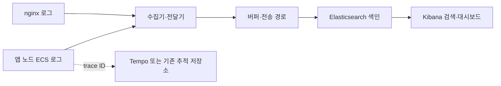

# 중앙 로그 수집 확장

현재 관측 구성은 로그 파일과 컨테이너 표준 출력, Loki 선택 스택을 사용한다. 이 문서는 로그량·보존·검색 요구가 커질 때 ELK 계열 중앙 수집으로 전환할 설계안이다. 현재 추적·경보는 [운영과 장애 대응](../operations.md)을 참고한다.

## 현재 구현

애플리케이션은 노드 이름이 포함된 ECS 구조화 로그를 기록하고, 앱 로그와 보안 감사 로그를 별도 파일·한도로 회전한다. 로컬 설정은 앱 로그 총 1GB, 감사 로그 총 500MB다. Compose 컨테이너는 json-file 로그 회전을 적용한다. 관측 프로필의 `grafana/otel-lgtm`에는 Loki·Prometheus·Tempo·Grafana가 포함되며 별도 Elasticsearch는 없다.

앱 로그는 요청 상관관계 ID와 trace ID로 요청·분산 추적을 연결한다. 토큰·메시지 본문 같은 민감 데이터를 검색 인덱스에 무분별하게 넣지 않는 것이 기본 원칙이다. 현재 구성은 개발·검증 용도라 중앙 로그의 장기 보존과 다중 노드 저장 내구성을 약속하지 않는다.

## 한계가 드러나는 조건

컨테이너가 삭제되거나 노드가 사라지면 로컬 파일도 함께 사라질 수 있다. 여러 노드 로그를 한 사건으로 검색하거나 장기간 감사 내역을 보관해야 할 때 파일 복사와 각 컨테이너 조회는 운영 부담이 된다. 로그량이 Loki 저장·색인 한도에 가까워지는 경우에도 수집량과 보존 기간을 분리해 계획해야 한다.

현 설정의 앱 로그 회전 상한은 노드당 1GB, 감사 로그는 500MB다. 전체 로그 처리량은 노드 수와 실제 회전 속도에 따라 달라지므로, 용량 임계 시점을 고정 수치로 제시하지 않는다. 중앙 수집기를 두기 전에 하루 로그 바이트, 노드 수, 검색 지연 목표, 보존 일수를 측정해야 한다.

## 설계안

수집기와 저장·검색을 앱 프로세스에서 분리한다.

앱은 stdout 또는 파일로 구조화 로그를 내고, Fluent Bit·OpenTelemetry Collector 같은 수집기가 노드에서 읽는다. Elasticsearch 인덱스는 앱 로그와 감사 로그를 분리하거나 보안 등급별 데이터 스트림으로 나눈다. Kibana 접근은 역할로 제한하고, 보존은 인덱스 수명주기 정책으로 정한다.

수집 단계에서 토큰·비밀번호·메시지 본문과 불필요한 사용자 식별자를 제거한다. trace ID와 request ID, 서비스·인스턴스 이름은 검색 가능한 필드로 두되, 세션 UUID를 높은 빈도의 지표 label로 사용하지 않는다. 전달기는 일시적 Elasticsearch 장애를 흡수하도록 디스크 버퍼와 재시도 한도를 가져야 한다.

## 전환 절차

1. 로그 필드 스키마와 민감정보 제외 규칙, 앱 로그와 감사 로그의 접근 정책을 확정한다.
2. 수집기를 기존 stdout과 병행 배치하고 일정 기간 두 경로의 로그 수·누락·지연을 비교한다.
3. Elasticsearch 인덱스 템플릿, 보존 정책, 접근 제어, 백업·복구 절차를 준비한다.
4. 장애 시 로컬 버퍼가 가득 찼을 때의 차단·폐기 정책을 검증하고 로그 유실 경보를 만든다.
5. 운영자가 Kibana에서 trace ID와 request ID로 앱·nginx 로그를 함께 찾는 훈련 후 기존 Loki를 축소하거나 병행 범위를 정한다.

## 트레이드오프

Elasticsearch는 검색·집계와 필드 기반 탐색이 강하지만, 색인·클러스터 운영·저장·백업 비용이 커진다. Loki는 로그 본문 검색과 라벨 중심 운영이 단순하지만 고카디널리티 필드를 라벨로 만들면 비용이 빠르게 늘 수 있다. 둘 중 무엇을 쓰든 로그는 보안 감사 원장이나 이벤트 로그의 대체물이 아니며, 정확한 업무 상태는 PostgreSQL에서 확인해야 한다.

중앙 전달은 노드 손실에 강하지만 수집기·네트워크 장애가 새로운 실패 경로가 된다. 디스크 버퍼를 키우면 일시 장애 내성이 올라가지만 노드 디스크 사용량과 복구 시 전송 부하가 증가한다. 감사 로그 보존은 용량보다 조직 정책과 접근 통제가 먼저다.

## 결정 기준

노드별 파일을 직접 모으는 시간이 검색·장애 대응을 늦추거나, 장기 보존·감사 접근 통제가 요구되면 중앙 수집을 도입한다. 이미 Grafana/Loki에서 검색 시간과 저장 비용이 요구 수준을 만족하면 ELK 전환은 보류한다. 선택은 일일 로그량, 보존 기간, 검색 질의 유형, 운영 인력과 보안 분류를 기준으로 한다.
