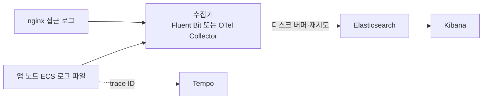

# 중앙 로그 수집 확장

노드가 늘고 로그를 오래 보관하며 여러 노드에 걸쳐 검색해야 할 때를 위한 설계다. 현재는 중앙 수집이 없다. 1단계는 이미 띄울 수 있는 관측 스택의 Loki로 보내는 것이고, 2단계는 검색·보존 요구가 커질 때 ELK(Elasticsearch·Kibana)로 옮기는 것이다. 현재 지표·추적·알림은 [운영과 장애 대응](../operations.md)을 본다.

## 현재 구현

| 로그 | 형식 | 저장 위치 | 보관 한도 |
|---|---|---|---|
| 앱 로그 | ECS JSON. 노드 이름, trace ID, `userId`·`sessionId`(MDC) 포함 | 앱 컨테이너의 `logs/app-{호스트}.log`(Compose 볼륨 `app-logs`) | 파일 50MB, 7일 보관, 합계 1GB |
| 감사 로그 | ECS JSON. 로그인, 토큰 갱신(재사용 감지 포함), 로그아웃·전체 로그아웃, 401·403 접근 거부. 비밀번호·토큰·본문은 남기지 않는다. 파일은 따로 쓰지만 콘솔에도 함께 나간다 | `logs/audit-{호스트}.log` | 파일 50MB, 30일 보관, 합계 500MB |
| 컨테이너 표준 출력 | 콘솔 로그, nginx 접근 로그 | Docker json-file 드라이버 | 10MB × 3개 |

관측 프로필의 `grafana/otel-lgtm` 이미지에는 Loki가 들어 있다. 하지만 앱은 지금 추적과 지표만 OTLP로 보낸다. `application.yml`의 `management.otlp.logging.export.enabled`는 `false`다. 따라서 로그는 노드마다 따로 남고, 여러 노드의 로그를 한곳에서 검색할 수 없다. 사건을 추적할 때는 nginx 접근 로그의 `upstream=` 주소로 처리한 노드를 찾은 뒤, 그 노드의 파일에서 trace ID나 `sessionId`로 찾는다.

## 한계가 드러나는 조건

- **노드 수:** 앱이 2~3대일 때는 노드별 파일을 직접 열어도 되지만, 노드가 늘고 자동으로 교체되면 어느 노드의 로그인지 찾는 일 자체가 장애 대응을 늦춘다.
- **보존:** 볼륨은 컨테이너를 지워도 남지만 호스트를 잃으면 함께 사라진다. 회전 한도를 넘은 로그도 지워진다. 감사 로그를 정해진 기간 보관해야 한다면 노드 밖에 사본이 있어야 한다.
- **검색:** 여러 노드에 걸친 한 사건을 trace ID로 묶어 보거나, 오류 유형별로 집계하려면 중앙 색인이 필요하다.

하루 로그량과 노드 수를 측정한 적은 없다. 도입 전에 노드당 하루 로그 바이트, 보존 일수, 검색 응답 목표를 먼저 정한다.

## 설계안

### 1단계: 기존 관측 스택의 Loki로 보내기

logback에 OpenTelemetry 어펜더를 추가하고 `management.otlp.logging.export.enabled`를 켜면 로그가 추적·지표와 같은 OTLP 경로로 Loki에 간다. 새 구성 요소가 없고, Grafana에서 trace ID로 추적(Tempo)과 로그(Loki)를 오갈 수 있다. 파일 로그는 그대로 두어 수집 경로가 끊겨도 노드에는 남게 한다.

### 2단계: ELK로 옮기기

Loki는 라벨로 고른 뒤 본문을 훑는 방식이라, 필드 기준 집계나 복잡한 조건 검색이 많아지면 한계가 온다. 이때 수집기와 저장소를 앱에서 떼어 ELK로 옮긴다.

- **수집:** 노드마다 수집기를 두고 파일을 읽는다. 앱은 파일에 쓰기만 하므로 수집기 장애가 요청 처리에 영향을 주지 않는다.
- **색인:** 앱 로그와 감사 로그를 서로 다른 인덱스(데이터 스트림)로 나눈다. 보존 기간과 접근 권한이 다르기 때문이다. 보존은 인덱스 수명주기 정책(ILM)으로 정한다.
- **민감 정보:** 토큰, 비밀번호, 메시지 본문은 수집 단계에서 지운다. 감사 로그는 지금도 이런 값을 남기지 않지만, 수집기에서 한 번 더 걸러 실수로 들어간 값이 색인되지 않게 한다.
- **필드:** ECS 필드명을 그대로 쓰므로 Elasticsearch에서 별도 변환 없이 검색할 수 있다. trace ID, `userId`, `sessionId`는 검색 필드로 두고, 세션 ID처럼 값이 많은 필드를 지표 라벨로 쓰지 않는다.

## 전환 절차

1. 1단계: 어펜더 추가와 설정 변경만으로 Loki 수집을 켜고, 파일 로그와 건수를 비교해 누락이 없는지 확인한다.
2. 2단계 준비: 필드 스키마, 민감 정보 제거 규칙, 앱·감사 로그 접근 권한, 보존 기간을 정한다.
3. 수집기를 Loki 경로와 병행해 배치하고, 일정 기간 두 경로의 건수·지연을 비교한다.
4. 수집기의 디스크 버퍼가 찼을 때 버릴지 막을지 정하고, 로그 유실 알림을 만든다.
5. 운영자가 Kibana에서 trace ID와 `sessionId`로 앱·nginx 로그를 함께 찾을 수 있는지 확인한 뒤 Loki 경로를 줄인다.

## 트레이드오프

| 선택 | 장점 | 비용 |
|---|---|---|
| 파일만(현재) | 구성 요소가 없다 | 노드별로 찾아야 하고, 호스트를 잃으면 로그도 잃는다 |
| Loki(1단계) | 이미 있는 관측 스택을 쓰고 추적과 바로 연결된다 | 필드 집계와 복잡한 검색에 약하다. 라벨에 값이 많은 필드를 넣으면 비용이 급격히 는다 |
| ELK(2단계) | 필드 검색과 집계가 강하고 보존·권한 정책이 세밀하다 | Elasticsearch 클러스터 운영, 저장, 백업 비용이 크다 |

어느 쪽이든 로그는 업무 상태의 근거가 아니다. 세션과 메시지의 정확한 상태는 PostgreSQL 이벤트에서 확인한다.

## 결정 기준

노드가 늘어 노드별 파일 조회가 장애 대응을 늦추기 시작하면 1단계를 켠다. 감사 로그의 장기 보관과 접근 통제가 요구되거나, Loki에서 필요한 검색·집계가 요구 시간 안에 끝나지 않으면 2단계로 간다. 판단 근거는 하루 로그량, 보존 기간, 자주 쓰는 검색 유형, 운영 인력이다.
