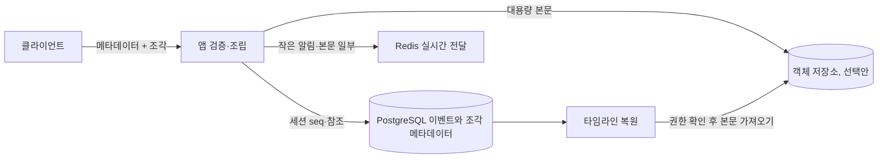

# 긴 메시지

현재 본문 상한 2000자는 단일 REST/STOMP 입력, 이벤트 행, 실시간 프레임으로 다룬다. 이 문서는 상한을 높이거나 본문을 별도 저장할 때의 설계안이며 현재 계약은 [API](../api.md)에 있다.

## 현재 구현

`chat.message.max-length` 기본값은 2000 유니코드 코드 포인트다. 본문은 `session_event.content`에 저장하고 복원 리듀서 질의에서는 읽지 않는다. STOMP 프레임 상한은 64KB, 연결 송신 버퍼는 512KB, resume 묶음은 256KB다. 현재는 메시지 본문을 여러 조각으로 나누거나 객체 저장소에 두지 않는다.

이 선택은 본문 저장과 전달을 단순하게 유지하고, 시점 복원 상태 계산이 큰 본문을 읽지 않게 한다. 단일 이벤트 조회·실시간 프레임에는 본문이 포함되므로 상한은 실제 네트워크와 메모리 사용에도 영향을 준다.

## 한계가 드러나는 조건

2000자보다 큰 메시지는 `EventIngestor`에서 `400 MESSAGE_TOO_LONG`으로 거절된다. 2000자는 한글·이모지를 섞어도 UTF-8로 약 8KB 이하라, JSON 이스케이프를 더해도 64KB 프레임과 256KB resume 상한 안에 여유 있게 들어간다. 상한을 단순히 크게 바꾸면 UTF-8 바이트 수는 문자 수보다 커질 수 있고, JSON 필드·프레임 헤더·이스케이프가 함께 들어가므로 64KB 프레임에 근접할 수 있다. 여러 동시 송신은 512KB 연결 버퍼를 채워 느린 클라이언트에서 전송 대기와 메모리 압박을 만든다.

텍스트·이모지·첨부 자료의 크기 분포를 측정해 실제 바이트 기준 p95·최댓값, 재전송·RESYNC 프레임 크기를 확인해야 한다. 저장소에는 부하 시험 결과가 없으므로 특정 사용자 수나 메시지 크기에서 한계가 온다고 단정하지 않는다.

## 설계안

일반 대화 본문은 기존 이벤트 행을 사용하고, 큰 본문은 메시지 메타데이터와 조각 저장을 분리한다.

입력 계약은 총 바이트 크기, 조각 수, 조각별 크기, 해시를 명시해야 한다. 서버는 모든 조각의 길이·해시를 검증한 뒤 하나의 메시지 이벤트에 `seq`를 부여한다. 수신자는 완성 알림과 다운로드 가능한 본문 참조를 받고, 권한 검사 뒤 본문을 받는다. 조립 전 실패·재시도·부분 업로드 만료를 정의해야 한다.

객체 저장소를 쓰면 본문이 이벤트 DB 트랜잭션과 원자적으로 커밋되지 않는다. 업로드 완료 임시 객체, DB 참조 확정, 고아 객체 정리 순서를 정하고, 본문 해시와 객체 버전을 이벤트에 남겨야 한다. 데이터베이스만으로 처리하려면 별도 조각 테이블과 완료 상태를 같은 DB 트랜잭션으로 관리할 수 있으나 WAL·백업 부하가 커진다.

## 전환 절차

1. 바이트 크기와 실제 대화 분포를 계측하고 새 상한을 정한다. 문자 수뿐 아니라 UTF-8 바이트와 직렬화 프레임 크기를 함께 제한한다.
2. API·STOMP·resume의 크기 상한을 서로 맞추고 상한을 넘는 입력이 REST에서는 지금처럼 `400 MESSAGE_TOO_LONG`, STOMP에서는 receipts의 같은 코드로 거절되는지 확인한다.
3. 외부 저장을 채택한다면 임시 업로드, 해시 검증, DB 참조 커밋, 고아 객체 회수 작업을 먼저 만든다.
4. 이벤트 스키마에 본문 참조와 버전을 추가하고 구형 클라이언트에 기존 작은 메시지 경로를 유지한다.
5. 타임라인·권한 확인·삭제 보존 정책과 노드 장애 중 업로드를 통합 시험한 뒤 제한된 사용자부터 전환한다.

## 트레이드오프

큰 단일 DB 본문은 트랜잭션과 백업이 단순하지만 WAL, 복제, 캐시, 이벤트 조회 응답 비용을 증가시킨다. 조각 테이블은 업로드 재개와 바이트 제한이 쉽지만 조립 질의와 부분 상태 정리가 필요하다. 객체 저장은 큰 본문 전달을 DB에서 분리하지만 권한 확인, 만료 URL, 고아 객체, DB와 저장소 사이의 부분 실패를 운영해야 한다.

실시간 채널에 본문 전체를 보내면 모든 구독자 송신 버퍼와 재연결 비용이 커진다. 참조만 보내면 별도 조회 왕복과 권한 경계가 생긴다. 어느 방식을 택해도 동일 seq·메시지 번호와 본문 해시를 유지해야 수정·중복 전송을 감지할 수 있다.

## 결정 기준

본문 분포가 현재 제한 안에 있고 프레임·DB 지표가 안정적이면 구현을 유지한다. 2000자 초과 요청이 실제 제품 요구로 반복되거나 DB/WAL·전송 버퍼가 병목으로 측정될 때 바이트 단위 제한 조정부터 검토한다. 큰 파일형 첨부가 주요 사용 사례가 되거나 DB 백업·복제 비용이 본문 때문에 급증하면 별도 저장소를 선택한다. 선택은 예상 최대 크기, 재개 가능성, 보존·삭제 요구, 일관성 비용으로 결정한다.
