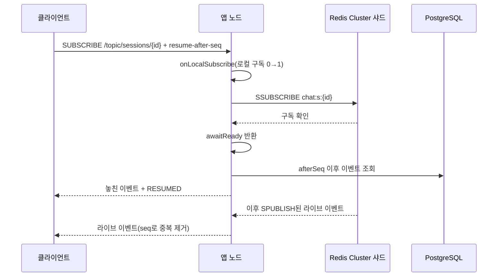

# 실시간 전달 수평 확장

앱 노드가 수십 대 이상으로 늘어날 때, 노드 사이 실시간 전달을 "모든 노드가 모든 세션 이벤트를 받는" 방식에서 "그 세션 구독자가 있는 노드만 받는" 방식으로 바꾸는 설계다. 현재 구현은 앞의 방식이고, 바꿀 지점은 코드에 미리 만들어 두었다. 현재 계약과 운영 설정은 [아키텍처](../architecture.md), [정합성과 상태 복원](../consistency-and-restore.md), [운영과 장애 대응](../operations.md)을 본다.

## 현재 구현

| 항목 | 현재(패턴 구독) |
|---|---|
| 구독 | 노드가 기동할 때 `PSUBSCRIBE chat:s:*`를 한 번 한다 |
| 발행 | 쓰기 노드가 커밋 직후 `PUBLISH chat:s:{sessionId}` |
| 수신 | 모든 노드가 모든 세션 이벤트를 받고, 자기 노드의 STOMP 구독자에게만 넘긴다 |
| Redis | 단일 인스턴스 |
| 빠진 구간 복구 | Pub/Sub는 메시지를 보관하지 않는다. PostgreSQL 이벤트와 `seq`로 resume하거나 `SYSTEM_RESYNC` 후 보충 API로 채운다 |

STOMP 계층은 Redis를 직접 부르지 않고 `RealtimeBus` 인터페이스만 호출한다. 구현은 `PatternRealtimeBus` 하나다.

| 메서드 | 호출하는 곳 | 현재 동작 |
|---|---|---|
| `publish(sessionId, event)` | `CommittedEventRelay`(커밋 직후) | `PUBLISH` |
| `onLocalSubscribe(sessionId)` | `StompInboundInterceptor`(세션 구독 허가 후) | 아무것도 하지 않음 |
| `onLocalUnsubscribe(sessionId)` | `StompInboundInterceptor`(구독 해제), `StompConnections`(연결 종료) | 아무것도 하지 않음 |
| `awaitReady(sessionId)` | `StompInboundInterceptor`(resume가 DB를 읽기 전) | 바로 돌아옴(패턴 구독은 기동 때 이미 확정) |

뒤의 세 메서드는 지금 비어 있지만 호출 위치는 이미 정해져 있다. 전환할 때는 이 인터페이스의 구현만 바꾸고, STOMP·resume 코드는 고치지 않는 것이 목표다.

## 한계가 드러나는 조건

노드 수를 `N`, 초당 이벤트 수를 `R`이라 하면 Redis가 내보내는 양과 노드 전체의 수신량은 `N × R`에 비례한다. 1:1 상담이라 한 세션의 구독자는 많아야 두 사람이고, 두 사람이 같은 노드에 붙을 수도 있다. 노드가 많아질수록 받은 이벤트 대부분을 버리게 되고, 버리는 데도 수신과 역직렬화 비용이 든다.

전환 시점을 정할 부하 측정은 아직 하지 않았다. 아래 지표를 노드 수를 바꿔 가며 측정하고 기준을 정한다.

- `chat_realtime_delivery_latency_milliseconds`(커밋 후 발행부터 전달까지 지연) p99
- Redis 출력 대역폭과 CPU, 클라이언트 출력 버퍼
- 노드별 수신 이벤트 중 로컬 구독자가 있었던 비율

## 설계안

Redis 7부터 있는 sharded Pub/Sub(`SSUBSCRIBE`, `SPUBLISH`)를 Redis Cluster에서 쓴다. 채널은 키처럼 해시 슬롯에 배치되므로 발행과 구독이 그 슬롯을 맡은 샤드 하나에서만 처리된다.

| 항목 | 현재(패턴 구독) | 전환 후(세션별 구독) |
|---|---|---|
| 구독 | 기동 때 `PSUBSCRIBE chat:s:*` 한 번 | 로컬 구독자가 생긴 노드만 `SSUBSCRIBE chat:s:{sessionId}` |
| 발행 | `PUBLISH chat:s:{sessionId}` | `SPUBLISH chat:s:{sessionId}` |
| 노드 1대의 수신량 | 전체 이벤트 | 자기 노드에 구독자가 있는 세션의 이벤트 |
| Redis | 단일 인스턴스 | Pub/Sub 전용 Redis Cluster를 따로 두고, presence·로그인 횟수 제한은 기존 단일 Redis에 남긴다 |

`ShardedRealtimeBus`를 새로 만들어 `RealtimeBus`의 빈 메서드를 채운다.

- `onLocalSubscribe`: 세션별 로컬 구독 수를 센다. 0에서 1이 될 때 `SSUBSCRIBE`를 보낸다.
- `onLocalUnsubscribe`: 1에서 0이 되면 곧바로 끊지 않고, 짧은 유예 뒤에도 0일 때 `SUNSUBSCRIBE`한다. 재연결이 잦을 때 구독과 해제가 반복되는 것을 막는다.
- `awaitReady`: Redis의 구독 확인 응답을 받을 때까지 기다린다. resume는 이 메서드가 돌아온 뒤에 DB를 읽는다. 그래야 "DB 조회 이후, 구독 확정 이전"에 발행된 이벤트가 빠지는 틈이 생기지 않는다. 지금의 resume 순서(구독 → DB 조회 → seq로 중복 제거)를 그대로 쓸 수 있다.
- `publish`: `SPUBLISH`로 바꾼다. 커밋 후 발행이라는 위치는 같다.

같은 Redis에 있는 presence Lua 스크립트는 단일 Redis를 전제로 여러 키(`ws:nodes`, `ws:node:{node}`, `pr:{user}` 등)를 스크립트 안에서 만들어 쓴다(`presence.lua` 주석). 이 키들은 해시 슬롯이 서로 달라 Cluster에서는 그대로 실행되지 않는다. 그래서 전달용 Cluster만 새로 두고 presence와 로그인 횟수 제한은 지금의 단일 Redis에 남긴다. presence까지 Cluster로 옮기려면 사용자별 해시태그로 키를 묶고 전역 키(`ws:nodes` 등)를 다시 설계해야 하는데, 이는 별도 작업이다.

전달은 지금처럼 보장하지 않는다. 샤드 장애나 슬롯 이동 중에는 구독이 끊길 수 있다. 다시 구독한 직후 그 세션의 로컬 구독자에게 `SYSTEM_RESYNC`를 보내 보충 API로 빈 구간을 채운다. 현재 패턴 구독이 끊겼다가 돌아올 때의 처리와 같은 규칙이다.

## 전환 절차

1. 부하 측정으로 전환 기준을 확인한다. 노드별 수신량 대비 로컬 전달 비율과 전달 지연 p99를 본다.
2. `ShardedRealtimeBus`를 만든다. 구독 수 집계, 해제 유예, 구독 확인 대기를 포함한다.
3. 설정값으로 구현을 고를 수 있게 한다. sharded Pub/Sub(`SPUBLISH`)로 보낸 메시지는 `PSUBSCRIBE` 구독자에게 전달되지 않으므로, 두 구현을 섞어 배포하면 노드 간 전달이 끊긴다. 전체 노드를 같은 설정으로 다시 배포한다.
4. 시험 환경의 Redis Cluster에서 지금의 클러스터 테스트(노드 간 전달, 100건 연속 전송, 노드 강제 종료 후 resume)와 샤드 장애·슬롯 이동 시나리오를 통과시킨다.
5. 운영에 배포하고 RESYNC 비율과 전달 지연을 비교한다. 문제가 생기면 설정을 되돌려 패턴 구독으로 돌아간다.

## 트레이드오프

| 얻는 것 | 잃는 것 |
|---|---|
| 노드 1대의 수신량이 전체 이벤트량이 아니라 자기 사용자 수에 비례한다 | Redis를 Cluster로 운영해야 한다. 샤드 장애와 슬롯 재배치를 다룰 줄 알아야 한다 |
| Redis 부하가 샤드로 나뉜다 | 노드마다 세션별 구독 상태(구독 수, 해제 유예)를 관리해야 한다 |
| presence는 지금 구현을 그대로 쓴다 | Redis가 전달용 Cluster와 presence용 단일 인스턴스, 두 벌이 된다 |
| STOMP·resume 코드는 그대로 둔다 | 구독할 때마다 Redis 확인 응답을 기다려 resume 시작이 그만큼 늦어진다 |

Kafka를 노드 간 전달에 쓰면 메시지를 보관해 재생할 수 있다. 하지만 지연이 늘고 노드마다 컨슈머를 운영해야 한다. 빠진 구간은 이미 DB와 seq로 메울 수 있으므로 이 용도에는 고르지 않았다.

## 결정 기준

전체 노드 전달이 Redis 대역폭·CPU 또는 전달 지연 p99의 반복 원인으로 확인되고, 노드가 받는 이벤트 중 로컬 구독자가 없는 비율이 높을 때 전환한다. 노드 수가 지금 구성(앱 2~3대)과 비슷한 범위에 머물고 이런 비용이 관측되지 않으면 패턴 구독을 유지한다. 운영할 구성 요소가 적은 쪽이 장애 지점도 적기 때문이다.
