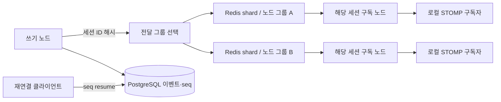

# 실시간 전달 수평 확장

이 문서는 현재 Redis 전체 노드 전달을 세션 단위 분배로 바꿀 때의 설계안이다. 현재 계약과 운영 설정은 [아키텍처](../architecture.md), [정합성과 상태 복원](../consistency-and-restore.md), [운영과 장애 대응](../operations.md)를 본다.

## 현재 구현

`PatternRealtimeBus`는 모든 앱 노드에서 Redis 패턴 채널을 구독한다. 이벤트를 쓴 노드가 커밋 후 세션 채널에 발행하면 각 노드가 수신하고, 자기 노드의 STOMP 구독자에게만 전달한다. 이 방식은 노드 수가 적을 때 별도의 소유권 표 없이 동작한다.

Redis Pub/Sub는 메시지를 보존하지 않는다. PostgreSQL 이벤트와 `seq`가 복구 기준이고, 클라이언트 재연결 시 최근 seq부터 resume한다. 빠른 경로는 단순하지만 노드 수가 늘면 모든 노드가 모든 세션의 이벤트를 수신한다.

## 한계가 드러나는 조건

노드 수를 `N`, 전체 이벤트 발행률을 `R`이라 하면 현재 전달 경로의 총 노드 수신량은 대략 `N × R`로 늘어난다. 대부분 노드에 해당 세션 구독자가 없어도 Redis 구독·역직렬화 비용은 발생한다. 세션 수와 노드 수가 함께 커지거나 Redis 대역폭이 먼저 포화되면 이 비용이 눈에 띈다.

수치 기준은 코드에 고정되어 있지 않다. `chat_realtime_delivery_latency_milliseconds`, CPU·네트워크, 연결 없는 채널을 포함한 Redis 수신량을 여러 노드 부하 시험으로 측정해 전환점을 정해야 한다. 현재 문서화된 동시 연결 제한은 노드당 사용자 5개이며, 실제 임계점은 메시지 크기와 구독 수에 따라 달라진다.

## 설계안

세션 ID를 안정적 해시의 입력으로 삼아 각 세션 이벤트를 일부 노드 그룹에만 전달한다.

세션 생성 후 어느 그룹에 속하는지와 노드 구독 수명주기를 정의해야 한다. Redis Cluster의 분할 Pub/Sub를 쓸 경우 채널에 샤드 키를 인코딩하고, 노드가 구독 세션을 얻거나 잃을 때 채널 구독을 갱신한다. 쓰기 노드는 모든 구독자 노드를 직접 알 필요 없이 그룹 채널에 한 번 발행한다.

전달 의미는 현재와 같이 최선 노력으로 둔다. 샤드 이동이나 구독 갱신 사이에 이벤트가 누락될 수 있으므로, DB seq resume와 `SYSTEM_RESYNC`는 계속 필요하다. 전달 보장이 필요하면 Kafka 같은 보존 로그를 구독 재생 경로에 넣어야 하며 이는 별도 계약과 비용이다.

## 전환 절차

1. 먼저 노드·채널별 수신량, 유효 구독 비율, Redis 지연과 `RESYNC` 비율을 측정한다.
2. 세션 ID → 그룹 계산을 버전 붙은 규칙으로 구현하고, 앱 노드가 로컬 활성 세션 구독을 갱신하는 제어 경로를 추가한다.
3. 일정 기간 기존 전체 전달과 새 경로를 병행하되, 중복은 seq로 제거하고 전달 도달률·지연을 비교한다.
4. 모든 노드가 같은 라우팅 버전을 사용하고 재연결 때 소유권을 다시 얻는지 확인한 뒤 새 경로를 기본으로 전환한다.
5. 롤백 기간에는 이전 패턴 구독을 유지하고, 안정화 후 제거한다. Redis 장애와 그룹 이동을 포함한 통합·클러스터 시험이 통과해야 한다.

## 트레이드오프

이 설계는 불필요한 노드 수신량과 Redis 네트워크 비용을 줄이지만, 세션 소유권·샤드 이동·배포 중 버전 호환을 관리해야 한다. 한 그룹에 인기 세션이 몰리면 해시 그룹도 불균형할 수 있다. 단순히 그룹 수만 늘리면 재배포 때 이동량이 커질 수 있으므로 가상 노드나 rendezvous hashing을 검토한다.

운영자는 전달 지연 개선이 제어면 복잡도보다 큰지 판단해야 한다. 장애 시 전체 전달로 되돌리면 가용성은 유지할 수 있지만 부하가 급증할 수 있어, 롤백 용량도 별도 검증 대상이다.

## 결정 기준

전체 노드 전달이 Redis 대역폭·CPU 또는 p99 지연의 반복 원인으로 확인되고, 무관한 노드가 받는 메시지 비율이 높을 때 전환한다. 연결·발행량이 현재 범위에 머물고 비용이 관측되지 않는다면 전체 전달을 유지하는 편이 장애 표면을 줄인다. 전환 전에는 예상 노드 수, 세션 수, 초당 이벤트, 이벤트 크기와 장애 시 RESYNC 처리량을 함께 정량화한다.
